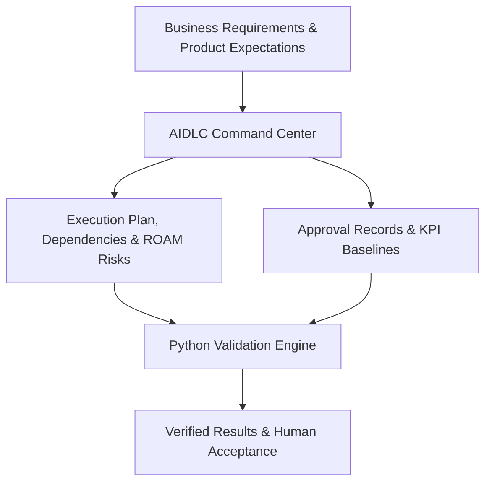
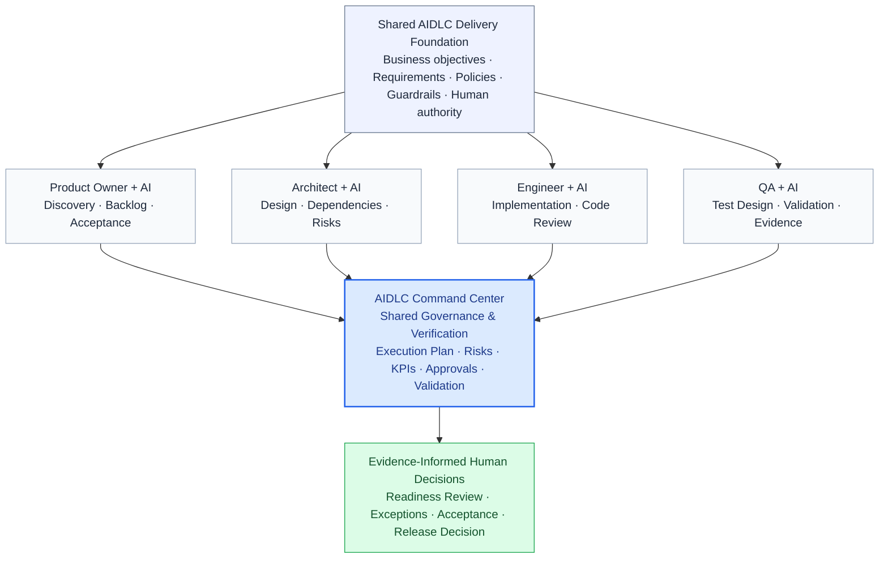
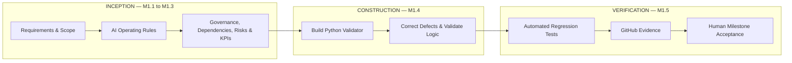

# CustomerConnect API | AI-Assisted Product Delivery Life Cycle

**From business intent to verifiable AI-assisted delivery.**

This portfolio project demonstrates how I connect business requirements, product delivery, technical implementation, and responsible AI adoption.

The objective is not simply to accelerate software development with AI, but to make execution **traceable, testable, and aligned with defined outcomes**.

**Current status:** Milestone 1 — AIDLC Command Center **completed and formally accepted**. Milestone 2 — CustomerConnect API development **authorized, not started**.

---

## The Business Challenge

AI can accelerate analysis, coding, and testing. But faster execution does not automatically mean teams are building the right solution.

Delivery teams still need visibility into:

- What requirements and decisions have been approved
- Which dependencies or risks could affect delivery
- Whether required evidence exists
- Whether implementation meets defined quality expectations
- Who is accountable for accepting the results

I developed a lightweight **AIDLC Command Center** to explore how these needs can be addressed without adding unnecessary process overhead.

## Solution at a Glance



The Command Center connects delivery artifacts with executable validation rules. Human decision-makers retain responsibility for business priorities, risk acceptance, and formal approvals.

## 2. AIDLC Prototype Operating Model

I designed this **prototype operating model** to explore how individuals can use AI to accelerate their own responsibilities while still collaborating through a shared delivery framework. The goal is not to make everyone use the same AI tool, but to keep requirements, delivery expectations, evidence, and human decisions connected.



### What the layers mean

- **Shared AIDLC Delivery Foundation — the common rules:** The team works from agreed objectives, requirements, policies, and decision rights, even when people use different AI assistants.
- **Role-specific AI assistance — the individual workspaces:** A Product Owner can use AI to refine requirements, an architect to explore design options, an engineer to draft and review code, and QA to develop test scenarios. Each person reviews their own outputs.
- **AIDLC Command Center — the shared checkpoint:** This is the layer I prototyped. Its structured records organize work, dependencies, risks, KPIs, and approval references. Its Python validator detects specified structural and integrity issues.
- **Evidence-informed human decisions — the accountability layer:** Checks and AI-generated insights support reviews, but authorized people decide whether work is accepted or ready for release.

### A simple example: CustomerConnect service discovery

Suppose a customer-service company needs customers to browse its available services. The Product Owner defines that need as **CC-R01**. The engineer builds `GET /services`, and QA verifies the expected response. The Command Center can record references to that requirement, the implementation, and the test evidence, then validate the integrity of its structured records. The Product Owner still decides whether the behavior meets the business need.

**What is demonstrated versus illustrative:** The Command Center's registers and validator are implemented and tested; the CustomerConnect service-discovery endpoint and automated tests also exist. The four role-specific AI workspaces and automatic flow of evidence between tools are **illustrations of the operating model**, not integrated applications or agents in this repository. The CC-R01 linkage has been made locally and is still undergoing review; it is not a fully automated traceability system.

## What I Built — Milestone 1

| Component | Purpose |
|---|---|
| AI operating instructions | Define responsibilities, boundaries, and human review expectations |
| Project charter template | Establish business context and expected outcomes |
| G1/G2/G3 gate definitions | Document lifecycle-readiness criteria |
| Execution plan | Track accountable work items and prerequisites |
| ROAM risk register | Document delivery risks, ownership, and response actions |
| KPI register | Distinguish planned targets from evidence-backed measurements |
| Approval register | Maintain records of human decisions |
| Python validator | Check CSV integrity, dependency correctness, and approval-record completeness |
| Regression-test suite | Verify valid inputs and simulated error conditions |

## How the Project Followed AIDLC



This reflects the delivery of the **Command Center itself**. The customer-facing API will follow its own AIDLC lifecycle during Milestone 2.

## Verified Technical Results

| Verification | Actual result |
|---|---|
| Automated regression tests | **13/13 passed** |
| CSV structure checks | **4/4 passed** |
| Dependency reference and cycle checks | Passed |
| Approval-record validation | Passed |
| Integrated validator execution | Exit code **0** |
| Git repository | Local `main` synchronized with `origin/main` at acceptance |
| Milestone 1 human acceptance | **Approved** |
| Human effort / productivity savings | **Not measured** |

These results demonstrate tested functionality of the initial Command Center. They do not establish measured productivity improvements or production deployment. The milestone acceptance is recorded in the project working conversation; no claim is made here that the final acceptance decision has been persisted into the CSV approval register.

## Explore the Repository

| Location | What to explore |
|---|---|
| [`aidlc-control/`](aidlc-control/) | Governance definitions, execution plan, risks, KPIs, and approvals |
| [`scripts/validate_command_center.py`](scripts/validate_command_center.py) | Python validator implementation |
| [`tests/test_command_center.py`](tests/test_command_center.py) | Automated positive and negative regression tests |
| [`aidlc-control/GATE_DEFINITIONS.md`](aidlc-control/GATE_DEFINITIONS.md) | Lifecycle readiness and decision-control model |

## Run It Yourself

**Requirements:** Python 3.12 is the tested local version. The implementation uses the Python standard library; no external packages are required.

Clone the repository:

```bash
git clone https://github.com/mdevi25/customerconnect-api.git
cd customerconnect-api
```

Run the validator:

```bash
python scripts/validate_command_center.py
```

Run the regression tests:

```bash
python -m unittest discover -s tests -p "test_*.py" -v
```

On the accepted Milestone 1 baseline, the expected result is four CSV structural checks passing, dependency and approval-record checks passing, and all thirteen regression tests passing.

## My Role and Contributions

I approached the project from both product leadership and technical implementation perspectives:

- Translated delivery challenges into requirements and an implementable solution.
- Defined a lightweight, human-governed AIDLC operating model.
- Established dependency-aware execution planning and risk traceability.
- Developed and verified executable Python validation functionality using AI-assisted development.
- Investigated defects, corrected implementation issues, and validated fixes.
- Managed Git/GitHub version control and demonstrated repeatable testing.

**The capability demonstrated:** Connecting business expectations with engineering execution—and making results inspectable, reproducible, and accountable.

## Current Limitations

The Command Center currently validates defined records and relationships. It does not independently authenticate human approvals, automatically optimize sprint priorities, orchestrate multiple agents, or measure realized production business outcomes.

These capabilities are deliberately outside the completed MVP scope.

---

**Portfolio focus:** Product Ownership · Technical Product Management · AI-Assisted Development · Requirements Traceability · Dependency Management · Automated Verification · Human-Governed Delivery
