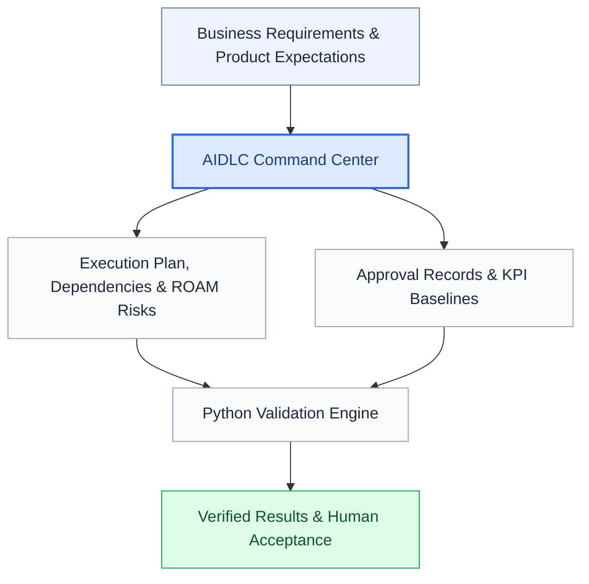

# CustomerConnect API | AI-Driven Development Life Cycle (AIDLC)

**From business intent to verifiable, AI-driven delivery.**

This portfolio project shows how I apply the [AWS AI-Driven Development Life Cycle (AI-DLC)](https://aws.amazon.com/blogs/devops/ai-driven-development-life-cycle/) from a product perspective, connecting business requirements, product delivery, technical implementation, and responsible AI adoption.

The objective is not simply to move faster with AI, but to make AI-driven execution **traceable, testable, and aligned with defined outcomes**. In short: AI drives the execution, and people own the decisions.

**Current status:** Milestone 1 (AIDLC Command Center) is **completed and formally accepted**. The first customer-facing requirement, **CC-R01**, has been built and tested and is awaiting human acceptance at Gate G2.

---

## The Business Challenge

AI can accelerate analysis, coding, and testing. But faster execution does not automatically mean teams are building the right solution.

Delivery teams still need visibility into:

- What requirements and decisions have been approved
- Which dependencies or risks could affect delivery
- Whether required evidence exists
- Whether implementation meets defined quality expectations
- Who is accountable for accepting the results

I developed a lightweight **AIDLC Command Center** to explore how these needs can be addressed without adding unnecessary process overhead.

## Solution at a Glance



The Command Center connects delivery artifacts with executable validation rules. Human decision-makers retain responsibility for business priorities, risk acceptance, and formal approvals.

## How This Applies AWS AI-DLC

AWS describes AI-DLC through one repeating pattern: **AI creates a plan, asks clarifying questions, and implements only after human validation.** Work runs in three phases (Inception, Construction, and Operations), and each phase provides richer context for the next.

| AWS AI-DLC concept | How this project applies it |
|---|---|
| AI-powered execution with human oversight | AI operating instructions define what AI does, its boundaries, and where human review is required |
| AI defers critical decisions to humans | A human gate closes each phase: **G1** (Inception), **G2** (Construction), **G3** (Operations), with recorded approvals |
| Persistent context stored in the project repository | The Command Center registers in [`aidlc-control/`](aidlc-control/) hold the plan, dependencies, risks, KPIs, and approvals |
| Traceability from requirements to deployment | Requirement IDs (such as CC-R01) are linked to implementation and test evidence, and the validator checks record integrity |
| Consistent application of organizational standards | Gate definitions and validator rules apply the same checks every time |

### Where I adapted the method deliberately

- **Individual AI workspaces instead of mob sessions.** AWS brings the whole team together for Mob Elaboration and Mob Construction. Many teams are distributed, so in my model each role uses its own AI tools and the Command Center serves as the shared space. Gate reviews are where the team comes together to decide.
- **Named gates.** AWS says AI defers critical decisions to people. I made those decisions explicit as G1, G2, and G3, each with written readiness criteria.
- **Milestones and requirement IDs.** For this solo prototype, I tracked work as milestones (M1.1 to M1.5) and requirement IDs, rather than AWS's bolts and Units of Work.

## AIDLC Prototype Operating Model

I designed this **prototype operating model** to explore how individuals can use AI to accelerate their own responsibilities while still collaborating through a shared delivery framework. The goal is not to make everyone use the same AI tool, but to keep requirements, delivery expectations, evidence, and human decisions connected.


### What the layers mean

- **Shared AIDLC Delivery Foundation (the common rules):** The team works from agreed objectives, requirements, policies, and decision rights, even when people use different AI assistants.
- **Role-specific AI assistance (the individual workspaces):** A Product Owner can use AI to refine requirements, an architect to explore design options, an engineer to draft and review code, and QA to develop test scenarios. Each person reviews their own outputs.
- **AIDLC Command Center (the shared checkpoint):** This is the layer I prototyped, and it plays the role of AI-DLC's persistent context. Its structured records organize work, dependencies, risks, KPIs, and approval references. Its Python validator detects specified structural and integrity issues.
- **Evidence-informed human decisions (the accountability layer):** Checks and AI-generated insights support reviews, but authorized people decide at each gate whether work is ready, accepted, or released.

**What is demonstrated versus illustrative:** The Command Center's registers and validator are implemented and tested; the CC-R01 service-browsing endpoint (`GET /services`) and its API tests also exist, outside the accepted milestone, with acceptance pending. The four role-specific AI workspaces and automatic flow of evidence between tools are **illustrations of the operating model**, not integrated applications or agents in this repository. Traceability between requirements, implementation, and tests is not yet automated.

## What I Built: Milestone 1

| Component | Purpose |
|---|---|
| AI operating instructions | Define responsibilities, boundaries, and human review expectations |
| Project charter template | Establish business context and expected outcomes |
| G1/G2/G3 gate definitions | Document readiness criteria for the Inception, Construction, and Operations gates |
| Execution plan | Track accountable work items and prerequisites |
| ROAM risk register | Document delivery risks, ownership, and response actions |
| KPI register | Distinguish planned targets from evidence-backed measurements |
| Approval register | Maintain records of human decisions |
| Python validator | Check CSV integrity, dependency correctness, and approval-record completeness |
| Regression-test suite | Verify valid inputs and simulated error conditions |

## How Milestone 1 Followed AIDLC

```mermaid
flowchart LR
    subgraph I["INCEPTION: M1.1 to M1.3"]
        A["Requirements & Scope"]
        B["AI Operating Rules"]
        C["Governance, Dependencies, ROAM Risks & KPIs"]
        A --> B --> C
    end

    subgraph D["CONSTRUCTION: M1.4 to M1.5"]
        E["Build Python Validator"]
        F["Correct Defects & Validate Logic"]
        G["Automated Regression Tests"]
        H["GitHub Evidence"]
        J["Human Milestone Acceptance"]
        E --> F --> G --> H --> J
    end

    C --> E

    classDef foundation fill:#eef2ff,stroke:#64748b,color:#1e293b
    classDef role fill:#f8fafc,stroke:#94a3b8,color:#1e293b
    classDef control fill:#dbeafe,stroke:#2563eb,stroke-width:2px,color:#1e3a8a
    classDef decision fill:#dcfce7,stroke:#16a34a,color:#14532d
    class A,B,C,E,F,G,H role
    class J decision
```



This reflects the delivery of the **Command Center itself**. Testing sits inside Construction, as it does in AWS AI-DLC. The Command Center runs locally from the repository and is not deployed, so Operations and its G3 gate were not in scope for this milestone.

## Verified Technical Results

| Verification | Actual result |
|---|---|
| Automated regression tests | **13/13 passed** |
| CSV structure checks | **4/4 passed** |
| Dependency reference and cycle checks | Passed |
| Approval-record validation | Passed |
| Integrated validator execution | Exit code **0** |
| Git repository | Local `main` synchronized with `origin/main` at acceptance |
| Milestone 1 human acceptance (Command Center) | **Approved** |
| Human effort / productivity savings | **Not measured** |

These results demonstrate tested functionality of the initial Command Center. They do not establish measured productivity improvements or production deployment. The milestone acceptance is recorded in the project working conversation; no claim is made here that the final acceptance decision has been persisted into the CSV approval register.

## One Customer Requirement, Traced End to End

This trace is separate from Milestone 1. Milestone 1 delivered the Command Center itself and was accepted; CC-R01 is the first customer-facing requirement to run through it.

**Story ID:** CC-R01<br>
**Title:** Browse Available Services

> As a customer, I want to view the services available to me so that I can select the appropriate service before submitting a service request.

| AIDLC step | Evidence | Status |
|---|---|---|
| Inception: business requirement | CC-R01, Browse Available Services | Defined |
| Construction: implementation | FastAPI `GET /services` endpoint | Committed to GitHub |
| Construction: verification | 4 API tests against the acceptance criteria, checking for HTTP 200 | Passing |
| Command Center: delivery records | Work item, dependencies, and evidence references linked to CC-R01 | Recorded |
| Gate G2: human acceptance | Product Owner decision | **Pending** |

The pending status is intentional. Passing tests produce evidence, but only the Product Owner can decide whether the behavior meets the customer need. Traceability between these records is maintained manually and validated for integrity; it is not yet automated.

## Explore the Repository

| Location | What to explore |
|---|---|
| [`aidlc-control/`](aidlc-control/) | Governance definitions, execution plan, risks, KPIs, and approvals |
| [`scripts/validate_command_center.py`](scripts/validate_command_center.py) | Python validator implementation |
| [`tests/test_command_center.py`](tests/test_command_center.py) | Automated positive and negative regression tests |
| [`aidlc-control/GATE_DEFINITIONS.md`](aidlc-control/GATE_DEFINITIONS.md) | G1/G2/G3 gate criteria and decision-control model |

## Run It Yourself

**Requirements:** Python 3.12 is the tested local version. The implementation uses the Python standard library; no external packages are required.

Clone the repository:

```bash
git clone https://github.com/mdevi25/customerconnect-api.git
cd customerconnect-api
```

Run the validator:

```bash
python scripts/validate_command_center.py
```

Run the regression tests:

```bash
python -m unittest discover -s tests -p "test_*.py" -v
```

On the accepted Milestone 1 baseline, the expected result is four CSV structural checks passing, dependency and approval-record checks passing, and all thirteen regression tests passing.

## My Role and Contributions

I approached the project from both product leadership and technical implementation perspectives:

- Translated delivery challenges into requirements and an implementable solution.
- Applied AWS AI-DLC and adapted it into a lightweight, human-governed operating model with explicit phase gates.
- Established dependency-aware execution planning and risk traceability.
- Developed and verified executable Python validation functionality using AI-assisted development.
- Investigated defects, corrected implementation issues, and validated fixes.
- Managed Git/GitHub version control and demonstrated repeatable testing.

**The capability demonstrated:** Connecting business expectations with engineering execution, and making results inspectable, reproducible, and accountable.

## Current Limitations

The Command Center currently validates defined records and relationships. It does not independently authenticate human approvals, automatically optimize priorities, orchestrate multiple agents, or measure realized production business outcomes.

These capabilities are deliberately outside the completed MVP scope.

---

**Portfolio focus:** Product Ownership · Technical Product Management · AI-Driven Development (AI-DLC) · Requirements Traceability · Dependency Management · Automated Verification · Human-Governed Delivery
